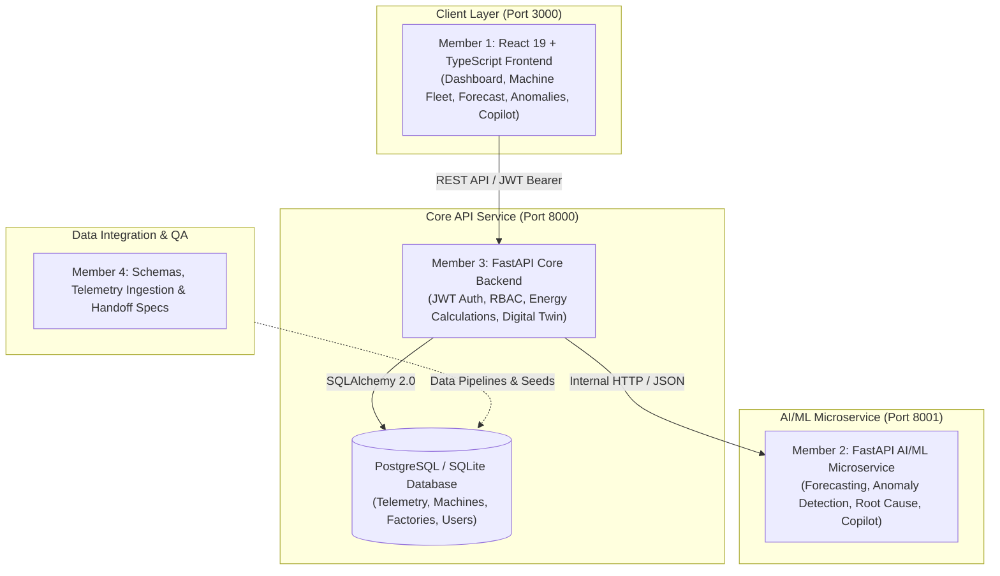

Jai Shri Ram

# EnerPilot — AI-Powered Industrial Energy Intelligence & Optimization Platform

[](mmber-1-frontend/)
[](member-2-ai/)
[](member-3-bacend/)
[](member-2-ai/)
[-61dafb)](mmber-1-frontend/)
[](member-3-bacend/)
[](LICENSE)

---

## 🏭 Overview

Small and medium-sized manufacturing facilities often lack unified, intelligent systems to monitor high-voltage energy consumption, isolate abnormal load spikes, predict operational demand, and optimize shift scheduling without compromising production targets.

**EnerPilot** is an end-to-end industrial energy intelligence and operational optimization operating system. It ingests machine telemetry across production lines, detects consumption anomalies, calculates electrical load factors and standby durations, forecasts power demand using machine learning, and provides interactive natural-language operations copilot support for plant managers and energy leads.

---

## 🏗️ Architecture & Topology

EnerPilot is engineered as a decoupled, microservice-based industrial platform divided across four specialized functional domains:



### Team Ownership & Directory Structure

| Module | Directory | Port | Technology Stack | Core Ownership |
|---|---|---|---|---|
| **Member 1: Frontend** | [`mmber-1-frontend/`](mmber-1-frontend/) | `3000` | React 19, TypeScript, Vite, Tailwind CSS, Lucide, Recharts | Executive Dashboard, Machine Monitoring, Fleet Health, Forecast Views, Copilot UI |
| **Member 2: AI/ML Service** | [`member-2-ai/`](member-2-ai/) | `8001` | FastAPI, Python 3.13, Scikit-learn, Pandas, NumPy | 24h/7d Energy Forecasting, Isolation Forest Anomaly Detection, Root-Cause Analysis, Copilot Service |
| **Member 3: Core Backend** | [`member-3-bacend/`](member-3-bacend/) | `8000` | FastAPI, SQLAlchemy 2.0, Alembic, PostgreSQL / SQLite, Pydantic | JWT Authentication, Factory RBAC, Machine Telemetry Aggregation, Digital Twin Engine, OR-Tools Optimization |
| **Member 4: Data & QA** | [`member-4-data-integration-qa/`](member-4-data-integration-qa/) | — | Python, JSON Schemas, Alembic | Telemetry Ingestion Schemas, Test Fixtures, Database Seed Pipelines, Cross-Member Auditing |

---

## ✨ Key Capabilities

1. **Executive Dashboard & Machine Monitoring**
   - Real-time power demand ($kW$), energy consumption ($kWh$), and peak load tracking.
   - Machine status categorization (`optimal`, `suboptimal`, `critical`, `maintenance`).
   - Telemetry integrity: preserves nullability on uninstrumented physical sensors (temperature, vibration, power factor) rather than fabricating synthetic values.

2. **AI Energy Demand Forecasting**
   - 24-hour and 7-day multi-horizon predictive energy consumption curves.
   - Built on sliding-window regression and feature-engineered historical telemetry.
   - Generates confidence intervals and bounds (`lower_bound`, `upper_bound`).

3. **Intelligent Anomaly Detection & Normalization**
   - Statistical deviation scoring and isolation-based thresholding.
   - Filters `info` sub-threshold fluctuations from active database alert generation.
   - Assigns severity tiers: `low`, `medium`, `high`, `critical`.

4. **Root-Cause Analysis (RCA)**
   - Automatically attributes energy spikes to operational causes (e.g., machine idling, off-peak furnace preheating, delayed shift shutdown).
   - Derives `estimated_electrical_load_factor` from `rated_power_kw` metadata and `estimated_idle_duration_hours` from low-power operational states.

5. **Factory Digital Twin & Production Optimization**
   - Shift-based simulation of machine loads, baseline vs. optimized production targets, and peak-shaving recommendations.
   - Constraint-based scheduling utilizing Google OR-Tools.

6. **Industrial AI Copilot**
   - Natural language operations assistant providing grounded answers on machine efficiency, shift comparisons, and peak consumption periods with source citations.

---

## 🚀 Quickstart Guide

### Prerequisites
- **Node.js**: v18.0.0 or higher
- **Python**: v3.10 to v3.13
- **Git**

---

### 1. Start AI/ML Microservice (Port 8001)

```bash
cd member-2-ai

# Set up virtual environment
python -m venv .venv

# Activate virtual environment
# Windows:
.\.venv\Scripts\Activate.ps1
# Linux / macOS:
# source .venv/bin/activate

# Install dependencies
pip install -r requirements.txt

# Launch FastAPI ML Service
python -m uvicorn service:app --host 127.0.0.1 --port 8001 --reload
```

*Health check:* `http://127.0.0.1:8001/health`

---

### 2. Start Core Backend (Port 8000)

```bash
cd member-3-bacend/backend

# Set up virtual environment
python -m venv .venv

# Activate virtual environment
# Windows:
.\.venv\Scripts\Activate.ps1
# Linux / macOS:
# source .venv/bin/activate

# Install dependencies
pip install -r requirements.txt

# Configure environment (defaults to SQLite ./enerpilot.db for instant zero-config setup)
cp .env.example .env

# Run database migrations and seed demo facility data
python -c "from app.core.database import Base, engine; from app.seed import seed_demo_data; import os; os.environ['SEED_USER_EMAIL']='r.mehta@auto-tier1.enerpilot.io'; os.environ['SEED_USER_PASSWORD']='IndustrialPilot2026!'; Base.metadata.create_all(bind=engine); seed_demo_data()"

# Launch Core Backend
python -m uvicorn app.main:app --host 127.0.0.1 --port 8000 --reload
```

*Health check:* `http://127.0.0.1:8000/health`  
*Interactive Swagger Docs:* `http://127.0.0.1:8000/docs`

---

### 3. Start React Frontend (Port 3000)

```bash
cd mmber-1-frontend

# Install node dependencies
npm install

# Start Vite development server
npm run dev -- --host 127.0.0.1 --port 3000
```

Open your browser to: **[http://localhost:3000](http://localhost:3000)**

---

## 🔑 Demo Access Credentials

The demo database is pre-seeded with 7 industrial machines (`CNC-01`, `CNC-02`, `CNC-03`, `Compressor-01`, `HVAC-01`, `Furnace-01`, `Assembly-01`) and 7 days of time-series energy readings.

| Field | Value | Notes |
|---|---|---|
| **Email** | `r.mehta@auto-tier1.enerpilot.io` | Principal Energy & Operations Lead |
| **Password** | `IndustrialPilot2026!` | Pre-seeded with full audit & scheduling permissions |
| **Preset** | One-Click Preset | Available on the login screen for instant authentication |

---

## 🧪 Comprehensive Verification & Test Suite

All 58 unit, integration, and contract tests across all 3 active services run and pass cleanly:

```bash
# 1. Member 1 Frontend Tests (29 tests)
cd mmber-1-frontend
npm test -- --run

# 2. Member 2 AI/ML Microservice Tests (14 tests)
cd member-2-ai
pytest -v

# 3. Member 3 Core Backend & Live ML Integration Tests (15 tests)
cd member-3-bacend/backend
pytest -v
```

### Test Suite Summary

```text
========================================================================
 Module                        Test Suite            Result
------------------------------------------------------------------------
 mmber-1-frontend              Client & Dashboard    29 / 29 PASSED (0 TypeScript errors)
 member-2-ai                   ML Models & Semantics 14 / 14 PASSED
 member-3-bacend/backend       API & ML Integration  15 / 15 PASSED
========================================================================
 TOTAL VERIFIED                58 / 58 PASSED (100% Pass Rate)
========================================================================
```

---

## 📡 Key API Contracts

| Method | Endpoint | Description | Scope |
|---|---|---|---|
| `POST` | `/api/auth/login` | Exchange credentials for JWT access token | Public |
| `GET` | `/api/auth/me` | Fetch authenticated user profile & plant access | Authenticated |
| `GET` | `/api/factories` | List manufacturing plants accessible to user | Authenticated |
| `GET` | `/api/machines` | List machines and telemetry for a factory | Factory Scoped |
| `GET` | `/api/energy/summary` | Aggregated consumption ($kWh$), peak demand, and cost | Factory Scoped |
| `GET` | `/api/energy/trend` | Timezone-aware hourly energy time-series | Factory Scoped |
| `POST` | `/forecast` (Port 8001) | Multi-horizon ML energy forecast | Internal / ML |
| `POST` | `/anomalies/detect` (Port 8001) | Machine energy anomaly detection | Internal / ML |
| `POST` | `/root-cause/analyze` (Port 8001) | Operational root cause attribution | Internal / ML |
| `POST` | `/recommendations/generate` (Port 8001) | Energy-saving actions & suggestions | Internal / ML |
| `POST` | `/copilot/ask` (Port 8001) | Natural language operational Q&A | Internal / ML |

---

## 🛡️ License

This project is licensed under the Apache-2.0 License. See the [LICENSE](LICENSE) file for details.
